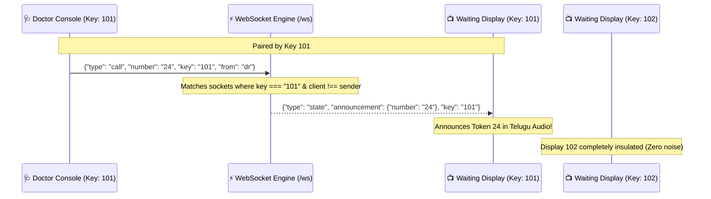

# 🏥 CareCall — Smart Clinic Queue Notifier

> **A resilient, real-time patient queue notification and token announcement system for clinics and hospitals.**  
> Powered by Node.js, WebSockets, Telugu voice announcements, and Station Key Pairing.

---

## 🌟 Overview

**CareCall** solves patient queue management in medical clinics without complex logins, databases, or cloud accounts:
1. **Doctor Station**: Doctors dial token numbers on a fast, touch-friendly mobile or desktop keypad.
2. **Waiting Area Display**: Wall-mounted TVs (e.g., Foxsky Smart TV, browser screens) display the active token in huge numbers, spell it out in Telugu, track elapsed consultation time, and announce patient calls in high-clarity Telugu audio.
3. **Station Key Pairing**: Multiple doctor consultation rooms run side-by-side simultaneously on the same server without cross-talk or call collisions.

---

## 🚀 Quick Start

### 1. Requirements
- **Node.js**: `>= 20.6.0` (Supports native `.env` loading)
- **NPM**: `>= 10.0.0`

### 2. Setup & Run
```bash
# Clone and enter directory
cd appointment-notifier-v1

# Install lightweight dependencies (sirv, ws)
npm install

# Start the server (reads PORT from .env or defaults to 3001)
npm start
```

Visit the dashboard in your browser:
```text
http://localhost:3001/
```

---

## 🔑 The Core Concept: Station Key Pairing

Instead of requiring user accounts, clinic staff pair devices using a simple **Station Key** (e.g., `101`, `Room 1`, `OPD-2`):



- **Zero-Friction UX**: Screens prompt for a Station Key on first load and remember it in browser storage.
- **Sender Exclusion**: When Doctor `101` calls a token, all paired displays ring, while the doctor's phone is ignored (`client !== sender`).
- **Dynamic In-Place Switching**: Click the key badge on any screen to change rooms instantly in `0ms` without reconnecting or leaving ghost connections.

---

## 🏛️ Architecture & Versioning

CareCall uses a **Pluggable Engine Architecture**. Client devices always connect to a single invariant endpoint:
```text
ws://localhost:3001/ws
```

Inside [`app.js`](file:///d:/KeshavSoftRepos/nov/21/appointment/appointment-notifier-v1/app.js), you switch the active backend engine with a single line:

```javascript
// ============================================================================
// WEBSOCKET BACKEND ENGINE HOOK
// Switch between v1 (classic broadcast) and v2 (targeted station keys):
// ============================================================================
import { attachWebSocketServer as attachV1 } from "./ws/v1/attachWebSocketServer.js";
import { attachWebSocketServer as attachV2 } from "./ws/v2/attachWebSocketServer.js";

// Currently hooked to V2 (change to attachV1 for instant rollback):
const attachWebSocketServer = attachV2;
```

### Version Matrix

| Layer | Version | Path | Description |
| :--- | :--- | :--- | :--- |
| **Backend** | **V1** | [`ws/v1/`](file:///d:/KeshavSoftRepos/nov/21/appointment/appointment-notifier-v1/ws/v1/) | Classic global broadcast. Frozen safety net. |
| **Backend** | **V2** | [`ws/v2/`](file:///d:/KeshavSoftRepos/nov/21/appointment/appointment-notifier-v1/ws/v2/) | Targeted Station Key registry with sender exclusion. |
| **Frontend** | **V1** | [`public/v1/`](file:///d:/KeshavSoftRepos/nov/21/appointment/appointment-notifier-v1/public/v1/) | Original TV, Doctor Mobile, and Desktop Workstation suite. |
| **Frontend** | **V2** | [`public/v2/`](file:///d:/KeshavSoftRepos/nov/21/appointment/appointment-notifier-v1/public/v2/) | Key-paired Doctor Console and Waiting Display with modal prompts. |
| **Frontend** | **V3** | [`public/v3/`](file:///d:/KeshavSoftRepos/nov/21/appointment/appointment-notifier-v1/public/v3/) | **Pure Architecture**: 100% self-contained folders, control-wise CSS, pure functional JS. |

---

## 📱 Frontend Screens & URLs

### Version 3 (Pure Control-Wise Architecture) — *Recommended*
- **Station Picker**: [`http://localhost:3001/v3/`](http://localhost:3001/v3/)
- **Doctor Console**: [`http://localhost:3001/v3/dr/`](http://localhost:3001/v3/dr/)
- **Waiting Area TV**: [`http://localhost:3001/v3/display/`](http://localhost:3001/v3/display/)

### Version 2 (Keyed Prototype Suite)
- **Station Picker**: [`http://localhost:3001/v2/`](http://localhost:3001/v2/)
- **Doctor Console**: [`http://localhost:3001/v2/dr.html`](http://localhost:3001/v2/dr.html)
- **Waiting Area TV**: [`http://localhost:3001/v2/display.html`](http://localhost:3001/v2/display.html)

### Version 1 (Classic Single-Doctor Suite)
- **Gateway**: [`http://localhost:3001/v1/`](http://localhost:3001/v1/)
- **TV Screen**: [`http://localhost:3001/v1/tv/`](http://localhost:3001/v1/tv/)
- **Doctor Mobile**: [`http://localhost:3001/v1/mobile/`](http://localhost:3001/v1/mobile/)
- **Desktop Workstation**: [`http://localhost:3001/v1/desktop/`](http://localhost:3001/v1/desktop/)

---

## ⚙️ Environment Configuration

CareCall uses Node's native `process.loadEnvFile()` (no extra npm dependencies).

### `.env` File
Create a `.env` in the root (already pre-configured):
```env
PORT=3001
```

- When running locally, the server binds to `PORT` specified in `.env`.
- When deployed to a cloud host (Render, Railway, Fly.io, Cloud Run), the platform's injected `process.env.PORT` automatically takes precedence.

---

## 🚢 Publishing & Production Deployment

CareCall is designed for zero-config cloud publishing:
1. **Start Command**:
   ```bash
   npm start
   ```
2. **Port Handling**: Fully dynamic via `process.env.PORT`.
3. **Automatic SSL / WSS Upgrade**:
   The frontend uses:
   ```javascript
   const protocol = window.location.protocol === "https:" ? "wss:" : "ws:";
   ```
   When deployed on an HTTPS domain, WebSocket connections automatically upgrade to secure **`wss://`** with zero code adjustments.

---

## 📚 Deep Dive Documentation

For detailed architectural analyses and narrative history, check the docs:
- 📖 [Architecture Deep Dive](file:///d:/KeshavSoftRepos/nov/21/appointment/appointment-notifier-v1/docs/ARCHITECTURE.md)
- 📖 [The Story & Evolution of CareCall](file:///d:/KeshavSoftRepos/nov/21/appointment/appointment-notifier-v1/docs/STORY_AND_ROADMAP.md)
